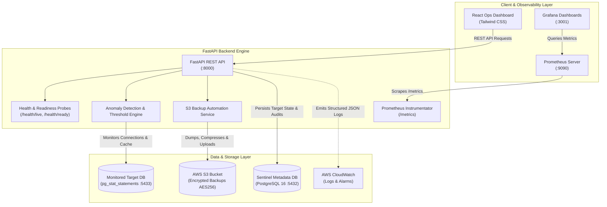
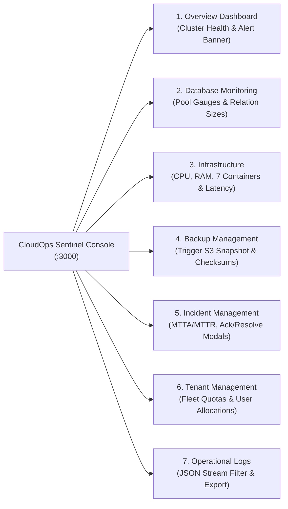

# CloudOps Sentinel 🛡️
### Production-Style Cloud Database Monitoring & Operations Automation Platform

[](https://github.com/your-org/cloudops-sentinel/actions/workflows/ci.yml)
[](https://www.python.org/)
[](https://fastapi.tiangolo.com)
[](https://www.postgresql.org/)
[](https://www.docker.com/)
[](LICENSE)

**CloudOps Sentinel** is an enterprise-grade cloud database monitoring, telemetry, and operations automation platform tailored for Cloud Operations Engineers and Site Reliability Engineers (SRE).

It delivers centralized visibility, continuous health probing, performance telemetry, threshold alerting, and automated maintenance routines (compressed backups to AWS S3, vacuum/analyze scheduling, failover simulations) across cloud database fleets (AWS RDS, Aurora PostgreSQL, self-hosted EC2 PostgreSQL, and containerized clusters).

---

## 🏗️ Architecture Overview



---

## 🚀 Key Cloud Operations Capabilities

- **Deep Database Observability:** Tracks active vs. idle connections, connection pool saturation %, buffer cache hit ratio, commits/rollbacks, deadlocks, and disk footprint.
- **Query Performance Auditing:** Pre-configured with PostgreSQL `pg_stat_statements` to detect and capture slow queries exceeding operational SLA thresholds (default: >500ms).
- **Automated S3 Disaster Recovery Backups:** Shell & Python automation routines that execute `pg_dump`, apply `gzip -6` stream compression, verify exit codes, and upload to AWS S3 with AES-256 Server-Side Encryption (`SSE-S3`) and retention tags.
- **Cloud-Ready Health Probing:**
  - `GET /api/v1/health/live`: Fast, zero-dependency liveness check for Kubernetes kubelet / Docker healthchecks / AWS Application Load Balancer target groups.
  - `GET /api/v1/health/ready`: Deep dependency check verifying metadata database connection and pool availability before routing traffic.
- **Incident Lifecycle Management:** Automatically flags metric violations (e.g., connection saturation > 80%, cache hit < 90%), registers incidents with severity levels (`WARNING`, `CRITICAL`), and supports engineer acknowledgement and resolution tracking.
- **Enterprise Security & Zero Hardcoded Credentials:** 100% environment-variable driven (12-Factor App), non-root Docker execution (`cloudops` UID:10001), and read-only monitoring database role (`monitor_agent`) utilizing PostgreSQL's `pg_monitor` grant.

---

## 📁 Repository Structure

```text
cloudops-sentinel/
├── .github/
│   └── workflows/
│       └── ci.yml                 # Automated linting (Ruff), security audit (Bandit), and tests
├── backend/
│   ├── alembic/                   # Database migration version control
│   │   ├── versions/
│   │   │   └── 0001_initial_schema.py # Initial database schema migration
│   │   ├── env.py                 # Dynamic Alembic environment runner
│   │   └── script.py.mako
│   ├── app/
│   │   ├── api/v1/
│   │   │   ├── endpoints/
│   │   │   │   ├── alerts.py      # Alert rules and incident lifecycle endpoints
│   │   │   │   ├── databases.py   # Target database inventory management
│   │   │   │   ├── health.py      # Liveness, readiness, and ops status probes
│   │   │   │   ├── metrics.py     # Timeseries snapshots and KPI summaries
│   │   │   │   └── operations.py  # Automation triggers (backups, vacuum, audit)
│   │   │   └── router.py          # API v1 route aggregator
│   │   ├── core/
│   │   │   ├── config.py          # Pydantic Settings with strict validation
│   │   │   ├── database.py        # SQLAlchemy 2.0 async engine & session pool
│   │   │   └── logging.py         # Structured JSON logging for CloudWatch
│   │   ├── models/                # SQLAlchemy 2.0 Declarative Entities
│   │   │   ├── alert.py           # AlertRule & AlertIncident
│   │   │   ├── base.py            # UUID PK and TimestampedBase mixin
│   │   │   ├── database_instance.py # Target database instances
│   │   │   ├── maintenance_task.py# Operational tasks & backup audit logs
│   │   │   └── metric_snapshot.py # Performance telemetry snapshots
│   │   ├── schemas/               # Pydantic v2 schemas for request/response validation
│   │   └── main.py                # FastAPI app with lifespan & Prometheus exporter
│   ├── tests/                     # Asynchronous test suite (pytest + httpx)
│   ├── alembic.ini                # Alembic CLI configuration
│   ├── Dockerfile                 # Minimal, non-root multi-stage image
│   ├── requirements.txt           # Production dependencies
│   └── requirements-dev.txt       # Linting, security scanning, and test dependencies
├── frontend/                      # React + Tailwind web UI
│   └── package.json
├── monitoring/
│   ├── prometheus/
│   │   └── prometheus.yml         # Prometheus scrape targets configuration
│   └── grafana/
│       └── provisioning/          # Automated datasource and dashboard provisioning
├── scripts/
│   ├── backup_db_to_s3.sh         # Production Bash script for automated S3 backup
│   ├── healthcheck.sh             # Bash diagnostic script for latency & connection audit
│   ├── init_db.sql                # SQL initialization: pg_stat_statements & sample schema
│   └── setup_dev.sh               # One-click local onboarding script
├── .env.example                   # Complete reference environment variables template
├── .gitignore                     # Git ignore rules for Python, Docker, React, and AWS
├── docker-compose.yml             # Orchestration for Sentinel DB, Monitored DB, Prometheus & Grafana
└── README.md                      # Architecture, runbooks, and setup guide
```

---

## ⚡ Quickstart: Local Development Setup

### Prerequisites
- [Docker Engine & Docker Compose](https://docs.docker.com/get-docker/) (v24+)
- Python 3.12 (optional for running locally outside container)

### 1. Initialize Environment Configuration
```bash
cp .env.example .env
```
*(Review `.env` and adjust passwords or port assignments if desired).*

### 2. Launch Container Infrastructure
Start the Sentinel metadata database, a simulated target PostgreSQL database, Prometheus, and Grafana:
```bash
docker compose up -d sentinel-db monitored-db prometheus grafana
```

Check container health status:
```bash
docker compose ps
```

### 3. Run Database Migrations
Apply the initial schema to the Sentinel metadata database using Alembic:
```bash
# If running locally with Python 3.12:
cd backend
python -m venv .venv
source .venv/bin/activate  # On Windows: .venv\Scripts\activate
pip install -r requirements-dev.txt
alembic upgrade head
cd ..

# Alternatively, run migrations using the backend Docker container:
docker compose run --rm backend alembic upgrade head
```

### 4. Start the Sentinel Backend API
```bash
docker compose up -d backend
```

---

## 🌐 Service Access Points

| Service | Address | Description | Credentials / Notes |
| :--- | :--- | :--- | :--- |
| **Sentinel Operations Console** | `http://localhost:3000` | Enterprise React Operations Dashboard | Dark Navy UI with 7 operational pages |
| **Sentinel API** | `http://localhost:8000` | REST API service | Root landing & service metadata |
| **Interactive Docs** | `http://localhost:8000/docs` | Swagger UI documentation | Interactive OpenAPI specification |
| **Liveness Probe** | `http://localhost:8000/health/live` | Healthcheck endpoint | Returns HTTP 200 `{"status": "UP"}` |
| **Database Probe** | `http://localhost:8000/health/db` | Async DB connection check | Validates `sentinel_db` socket & latency |
| **Operations Summary** | `http://localhost:8000/ops/db-summary`| DB storage & tenancy summary| Active connections, relations & tenants |
| **FastAPI Metrics**| `http://localhost:8000/metrics` | Prometheus exposition | Scraped by Prometheus container |
| **Postgres Exporter** | `http://localhost:9187/metrics` | PostgreSQL metrics exporter | Database metrics, cache hit, transactions |
| **Prometheus UI** | `http://localhost:9090` | Telemetry scraping engine | Scrape targets, PromQL, Alert evaluation |
| **Prometheus Alerts**| `http://localhost:9090/alerts` | Alert rules engine | 7 production alerting thresholds |
| **Alertmanager UI** | `http://localhost:9093` | Alert dispatch & routing engine| Groups and routes alerts to Sentinel |
| **Grafana Dashboard**| `http://localhost:3001` | CloudOps Sentinel Dashboard | Auto-provisioned: `admin` / `admin` |
| **Incidents API** | `http://localhost:8000/api/v1/incidents/` | Incident Management & Lifecycle | List, acknowledge, resolve, escalate |
| **Incident SLA Metrics**| `http://localhost:8000/api/v1/incidents/metrics/sla`| Response & Resolution Metrics | MTTA, MTTR, SLA compliance % |
| **Sentinel DB** | `localhost:5434` | Primary Metadata Database | PostgreSQL 16 container (`sentinel_db`) |
| **Target Database** | `localhost:5433` | Simulated Production DB | `ecommerce_production` with `pg_stat_statements` |

---

## 📊 Observability & Monitoring Infrastructure

CloudOps Sentinel integrates a comprehensive Prometheus + Grafana observability stack with pre-configured scraping, dynamic provisioning, and SLA alert rules.

### 1. Prometheus Scraping Architecture (`monitoring/prometheus/prometheus.yml`)
- **FastAPI Telemetry (`sentinel-backend:8000/metrics`):** Emits request throughput (`http_requests_total`), latency percentiles (`http_request_duration_seconds`), response sizes, memory, and CPU utilization.
- **PostgreSQL Exporter (`sentinel-postgres-exporter:9187/metrics`):** Emits database engine telemetry including `pg_up`, connection counts (`pg_stat_activity_count`), table/catalog size (`pg_database_size_bytes`), commit/rollback transactions, deadlocks, and buffer hit rates.
- **Prometheus Self-Monitoring (`localhost:9090`):** Ingestion rate and rule evaluation telemetry.

### 2. Prometheus Production Alert Rules (`monitoring/prometheus/alert.rules.yml`)
| Rule Name | Severity | Condition | Threshold / Meaning |
| :--- | :--- | :--- | :--- |
| **`DatabaseDown`** | Critical | `pg_up == 0` for 30s | Database unreachable |
| **`DatabaseConnectionPoolCritical`** | Critical | Active / Max connections >= 90% for 1m | Pool near exhaustion |
| **`DatabaseConnectionPoolWarning`** | Warning | Active / Max connections >= 75% for 2m | Elevated connection concurrency |
| **`LowBufferCacheHitRatio`** | Warning | Cache hit ratio < 90% for 5m | Inefficient queries reading from disk |
| **`DatabaseDeadlocksDetected`** | Warning | `increase(pg_stat_database_deadlocks[5m]) > 0` | Concurrent transaction deadlocks |
| **`HighApiErrorRate5xx`** | Critical | 5xx errors > 5% for 2m | API backend failing requests |
| **`HighApiLatencyP95`** | Warning | p95 response time > 500ms for 3m | API degradation violating SLA |

### 3. Automated Grafana Operations Dashboard (`cloudops-sentinel-overview`)
Provisioned automatically via YAML, organized into 5 operational rows containing 14 visual panels:
- **System Health & Core KPIs:** Database Availability (Stat), Connection Pool Saturation % (Gauge), Buffer Cache Hit Ratio (Gauge), Storage Footprint (Stat), Transaction Throughput (Stat), API p95 Response Latency (Stat).
- **Database Connections & Concurrency Trends:** Active/Idle/Idle-in-Transaction breakdown timeseries and connection saturation % trend.
- **Query Performance & Storage Capacity:** Commits vs. Rollbacks/sec and Buffer Cache Hits vs. Disk Reads/sec.
- **FastAPI HTTP Ingress, Latency & Error Rates:** Request rate by HTTP status code (2xx, 4xx, 5xx) and API latency percentiles (p50, p90, p95, p99).
- **Host & Container System Resources:** Process CPU Usage % and Resident Memory Footprint (RSS).

### 4. Running the Verification Test Suite
Execute the full automated test suite covering Phase 1 database constraints, Phase 2 FastAPI endpoints, Phase 3 Bash automation scripts, Phase 4 Prometheus/Grafana monitoring, and Phase 5 Incident Management:
```bash
python -m pytest backend/tests/ -v
```

---

## 🚨 Incident Management & SRE Escalation Engine

CloudOps Sentinel provides an enterprise SRE incident lifecycle management system with Prometheus Alertmanager webhook ingestion, automatic deduplication, tiered escalation, response/resolution SLA tracking, and disaster recovery simulation drills.

### 1. Severity Levels & SLA Targets
- **`CRITICAL` (P1):** Database outage or connection exhaustion $\ge 90\%$. Target Ack: $\le 15$m; Target Resolve: $\le 1$h. Auto-escalates at 5m and 15m.
- **`HIGH` (P2):** Low cache hit ratio $<90\%$, pool saturation $\ge 75\%$, API 5xx errors $>5\%$. Target Ack: $\le 30$m; Target Resolve: $\le 4$h. Auto-escalates at 15m.
- **`MEDIUM` (P3):** Disk storage $>75\%$ warning. Target Ack: $\le 1$h; Target Resolve: $\le 24$h.
- **`LOW` (P4):** Minor warnings and probe anomalies. Target Ack: $\le 24$h; Target Resolve: $\le 72$h.

### 2. SRE Outage & Disaster Recovery Simulation Drill
CloudOps Sentinel includes an automated drill script ([scripts/incident_drill.sh](file:///c:/Users/rayin/OneDrive/Desktop/C/scripts/incident_drill.sh)) that safely simulates a production target outage, detects downtime, dispatches an Alertmanager alert, verifies on-call engineer triage, restores the database, and computes MTTR.

```bash
# Execute safe disaster recovery drill (restricted strictly to monitored-postgres)
./scripts/incident_drill.sh localhost 5433 postgres ecommerce_production
```

For complete incident management runbooks, escalation procedures, and API specifications, see [docs/runbooks/INCIDENT_MANAGEMENT.md](file:///c:/Users/rayin/OneDrive/Desktop/C/docs/runbooks/INCIDENT_MANAGEMENT.md).

---

## 🖥️ Enterprise Cloud Operations Dashboard Console

CloudOps Sentinel features a unified, mission-critical React operations console built with **Vite, TypeScript, Tailwind CSS, and Recharts**. Designed specifically for Cloud Operations Engineers and SREs, it replaces scattered monitoring views with a cohesive, dark-navy command center (`#070B12`, `#0D1424`, `#1B2742`) displaying live telemetry directly from FastAPI endpoints without any mock data.

```
Access URL: http://localhost:3000
```

### 1. Architectural Highlights
- **100% Real Backend Telemetry:** Direct integration with `/api/v1/ops/db-summary`, `/api/v1/health/db`, `/api/v1/incidents/`, `/api/v1/incidents/metrics/sla`, `/api/v1/ops/tenants`, `/api/v1/ops/infra`, `/api/v1/ops/backups`, and `/api/v1/ops/logs`.
- **Zero Excessive Animations:** Ultra-clean, distraction-free typography with Inter and JetBrains Mono monospace readouts.
- **Resilient UI States:** Built-in animated loading skeletons, graceful error banners with manual retry triggers, and descriptive empty states.
- **Containerized Nginx Proxy:** Single-stage Vite build served by an Alpine Nginx reverse proxy routing API, health, and metrics calls directly to the internal Docker backend network.
- **Global Polling & SRE Refresh:** Auto-refreshes state every 30 seconds with immediate on-demand manual refresh capability.

---

### 2. Operational Pages & Capabilities



| Page | Key Capabilities & Visualizations | Live Endpoints Queried |
| :--- | :--- | :--- |
| **1. Overview Dashboard** | System health status banner, 4 KPI cards (Availability, Saturation, Storage, Tenants), active firing incident banner, Recharts active vs. idle connection area chart, multi-container service grid, and tenant health summary. | `/api/v1/ops/db-summary`, `/api/v1/health/db`, `/api/v1/incidents/` |
| **2. Database Monitoring** | PostgreSQL 16 cluster version header, Active/Idle/Transaction connection breakdown, saturation progress gauge with 75% warning & 90% critical threshold markers, Recharts horizontal bar chart of top relations, and catalog storage table. | `/api/v1/ops/db-summary`, `/api/v1/health/db` |
| **3. Infrastructure Monitoring** | Process CPU % gauge, memory RSS/VMS footprints, open file descriptors, process uptime counter, 7-container service topology map with live latency probes, and Prometheus scraper pool statuses. | `/api/v1/ops/infra` |
| **4. Backup Management** | AWS S3 disaster recovery summary cards, interactive **"Trigger S3 Backup Now"** action button with live API execution, snapshot history table, SHA256 checksum one-click copy, and retention policies. | `/api/v1/ops/backups`, `/api/v1/ops/backups/trigger` |
| **5. Incident Management** | MTTA, MTTR, and SLA compliance KPI cards, severity breakdown, multi-facet filtering (search, severity, status), interactive **Acknowledge** modal, **Resolve** modal with required resolution notes, and immutable **Full Audit History** modal. | `/api/v1/incidents/`, `/api/v1/incidents/metrics/sla`, `/api/v1/incidents/{id}/acknowledge`, `/api/v1/incidents/{id}/resolve` |
| **6. Tenant Management** | Multi-tenant fleet metrics, subscription tier filter (ENTERPRISE, PRO, STARTER, FREE), status filters, real-time search, user seat allocation progress bars, and disk storage quota utilization. | `/api/v1/ops/tenants` |
| **7. Operational Logs** | Structured operational log event stream, level filters (ALL, INFO, WARN, ERROR), search query matching, timestamped events, component tags, and **Export JSON** utility for external audit. | `/api/v1/ops/logs` |

---

### 3. Local Frontend Development
To run the frontend locally in development mode with Hot Module Replacement (HMR):
```bash
cd frontend
npm install
npm run dev
# Vite dev server runs at http://localhost:3000 with proxy to http://localhost:8000
```

To build and type-check the production bundle:
```bash
cd frontend
npm run build
```

---

## 📋 Cloud Operations Runbooks

CloudOps Sentinel provides formal Standard Operating Procedures (SOPs) for Site Reliability Engineers and Cloud Operations personnel:

| Runbook ID | Title & Focus Area | Target SLA / Scenario | Link |
| :--- | :--- | :--- | :--- |
| **SRE-OPS-001** | **Incident Lifecycle & Alertmanager Escalation** | P1-P4 Outages, Alert deduplication, MTTR tracking | [INCIDENT_MANAGEMENT.md](docs/runbooks/INCIDENT_MANAGEMENT.md) |
| **SRE-AWS-DEP-001** | **AWS Cloud Deployment & Automated Rollback** | EC2, RDS PostgreSQL 16, S3, Preflight & Rollback | [AWS_DEPLOYMENT_AND_ROLLBACK.md](docs/runbooks/AWS_DEPLOYMENT_AND_ROLLBACK.md) |
| **SRE-DB-CONN-002** | **Connection Pool Exhaustion & Idle-in-Trans** | Pool Saturation $\ge 80\%$, Lock releases, Evictions | [DATABASE_CONNECTION_POOL_EXHAUSTION.md](docs/runbooks/DATABASE_CONNECTION_POOL_EXHAUSTION.md) |
| **SRE-DR-RES-003** | **Disaster Recovery & Database Restoration** | S3 Snapshots, Non-destructive drills, SHA256 audit | [DISASTER_RECOVERY_AND_RESTORE.md](docs/runbooks/DISASTER_RECOVERY_AND_RESTORE.md) |
| **FINOPS-AWS-001** | **AWS Pricing, Free-Tier & Cost Guardrails** | \$0.00/mo Free Tier optimization, Budget alarms | [AWS_PRICING_AND_FREE_TIER.md](aws/pricing/AWS_PRICING_AND_FREE_TIER.md) |

---

### Runbook 1: Executing Automated S3 Database Backup
To initiate an immediate backup and transfer to AWS S3:
```bash
# Set runtime variables or load from .env
export DB_HOST="localhost"
export DB_PORT="5433"
export DB_NAME="ecommerce_production"
export DB_USER="postgres"
export PGPASSWORD="target_secret_dev_pass"
export S3_BACKUP_BUCKET="my-company-cloudops-backups"

# Execute production bash automation
chmod +x scripts/backup_db_to_s3.sh
./scripts/backup_db_to_s3.sh
```

### Runbook 2: Investigating Connection Pool Saturation
When an alert triggers for `connection_pool_usage_pct > 80%`:
1. Check the active probe directly:
   ```bash
   ./scripts/healthcheck.sh localhost 5433 postgres ecommerce_production
   ```
2. Query active client connections and idle states:
   ```sql
   SELECT pid, usename, client_addr, state, query_start, query 
   FROM pg_stat_activity 
   WHERE state != 'idle' 
   ORDER BY query_start ASC;
   ```
3. If unmanaged connection leaks occur, terminate idle-in-transaction connections older than 5 minutes:
   ```sql
   SELECT pg_terminate_backend(pid) 
   FROM pg_stat_activity 
   WHERE state = 'idle in transaction' 
     AND state_change < current_timestamp - INTERVAL '5 minutes';
   ```

### Runbook 3: Identifying Slow Queries with `pg_stat_statements`
Query the top 5 most expensive database queries by total execution time:
```sql
SELECT 
    round(total_exec_time::numeric, 2) AS total_time_ms,
    calls,
    round(mean_exec_time::numeric, 2) AS avg_time_ms,
    round((100 * total_exec_time / sum(total_exec_time) OVER ())::numeric, 2) AS pct_cpu,
    query
FROM pg_stat_statements
ORDER BY total_exec_time DESC
LIMIT 5;
```

---

## 🔒 Security & Cloud Best Practices

1. **Least-Privilege Database Access:** The monitoring user (`monitor_agent`) has read-only access to system catalog stats via `GRANT pg_monitor TO monitor_agent;` and cannot modify user tables.
2. **Encrypted Cloud Backups:** Backups uploaded to AWS S3 enforce Server-Side Encryption (`AES256` or AWS KMS) and use `STANDARD_IA` storage class to optimize cloud cost.
3. **Non-Root Containers:** Backend Docker container executes as unprivileged user `cloudops` (UID 10001) to minimize container escape attack surfaces.
4. **Structured Logging:** Output logs are JSON-formatted in production to integrate cleanly with CloudWatch Logs Insights, Datadog, or Grafana Loki.

