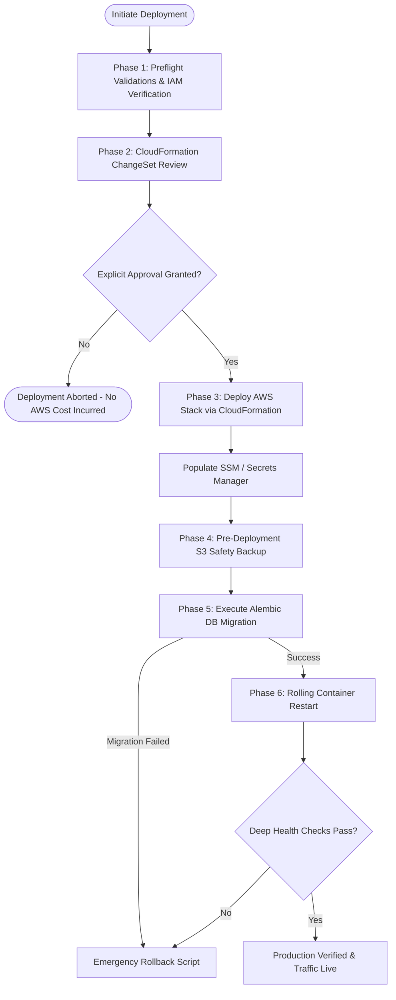

# CloudOps Sentinel: AWS Deployment & Rollback Runbook 📘
**Role Alignment:** Associate Cloud Operations Engineer / Site Reliability Engineer  
**Scope:** AWS EC2, Amazon RDS PostgreSQL 16, Amazon S3, CloudWatch & IAM  
**Standard Operating Procedure (SOP):** SRE-AWS-DEP-001  

---

## 1. Overview & Safety Architecture

This runbook defines the end-to-end standard operating procedure for deploying, verifying, and rolling back **CloudOps Sentinel** on Amazon Web Services.

### Key Operational Guarantees:
- **Zero Hardcoded Credentials:** 100% IAM Instance Profile-driven; secrets stored in AWS SSM Parameter Store / Secrets Manager.
- **Pre-Migration Safety Snapshots:** Automatic database snapshot pushed to S3 before any database migration is executed.
- **Fail-Safe Health Probing:** Deployment halts and rolls back if liveness or readiness probes do not return HTTP 200 within 60 seconds.
- **Zero Downtime / Minimal Downtime:** Blue/Green or atomic container swap with Nginx upstream routing.



---

## 2. Phase 1: Preflight Verification Checklist

Execute locally prior to any AWS deployment commands:

```bash
# 1. Verify AWS CLI is authenticated with proper account
aws sts get-caller-identity

# 2. Confirm target AWS Region (default: us-east-1)
export AWS_REGION="us-east-1"
echo "Target Region: ${AWS_REGION}"

# 3. Validate CloudFormation template syntax (offline validation - zero cost)
aws cloudformation validate-template \
    --region "${AWS_REGION}" \
    --template-body file://aws/cloudformation/cloudops-sentinel-aws.yml

# Expected Output: Description and Parameters listed with zero syntax errors.
```

---

## 3. Phase 2: Populating Application Secrets in AWS

Store production database and application secrets in **AWS Systems Manager (SSM) Parameter Store** (Standard Tier is **100% Free**):

```bash
# Generate secure random strings
DB_PASS=$(openssl rand -base64 24 | tr -dc 'a-zA-Z0-9' | head -c 20)
APP_SECRET=$(openssl rand -hex 32)
GRAFANA_PASS=$(openssl rand -base64 16 | tr -dc 'a-zA-Z0-9' | head -c 16)

# Store in SSM Parameter Store with SecureString (KMS) encryption
aws ssm put-parameter \
    --region "${AWS_REGION}" \
    --name "/cloudops-sentinel/production/POSTGRES_PASSWORD" \
    --value "${DB_PASS}" \
    --type SecureString \
    --overwrite

aws ssm put-parameter \
    --region "${AWS_REGION}" \
    --name "/cloudops-sentinel/production/SECRET_KEY" \
    --value "${APP_SECRET}" \
    --type SecureString \
    --overwrite

aws ssm put-parameter \
    --region "${AWS_REGION}" \
    --name "/cloudops-sentinel/production/GRAFANA_ADMIN_PASSWORD" \
    --value "${GRAFANA_PASS}" \
    --type SecureString \
    --overwrite
```

---

## 4. Phase 3: Infrastructure Provisioning (Awaiting Explicit User Approval)

> [!IMPORTANT]
> **SAFETY GATE:** Do NOT execute the stack creation command until you have received explicit confirmation from the infrastructure owner.

### Step 3.1: Create a Dry-Run Change Set
```bash
aws cloudformation create-change-set \
    --region "${AWS_REGION}" \
    --stack-name "cloudops-sentinel-production" \
    --change-set-name "SentinelInitialRelease" \
    --template-body file://aws/cloudformation/cloudops-sentinel-aws.yml \
    --parameters \
        ParameterKey=Environment,ParameterValue=production \
        ParameterKey=DBInstanceClass,ParameterValue=db.t4g.micro \
        ParameterKey=DBAllocatedStorage,ParameterValue=20 \
        ParameterKey=DBMultiAZ,ParameterValue=false \
        ParameterKey=DBMasterUsername,ParameterValue=sentinel_admin \
        ParameterKey=DBMasterPassword,ParameterValue="${DB_PASS}" \
        ParameterKey=EC2InstanceType,ParameterValue=t4g.small \
    --capabilities CAPABILITY_NAMED_IAM
```

### Step 3.2: Inspect the Change Set
```bash
aws cloudformation describe-change-set \
    --region "${AWS_REGION}" \
    --stack-name "cloudops-sentinel-production" \
    --change-set-name "SentinelInitialRelease"
```

### Step 3.3: Execute Change Set (Upon Explicit Approval Only)
```bash
aws cloudformation execute-change-set \
    --region "${AWS_REGION}" \
    --stack-name "cloudops-sentinel-production" \
    --change-set-name "SentinelInitialRelease"

# Wait for stack completion (typically 8-12 minutes for RDS PostgreSQL provisioning)
aws cloudformation wait stack-create-complete \
    --region "${AWS_REGION}" \
    --stack-name "cloudops-sentinel-production"
```

### Step 3.4: Retrieve Stack Outputs
```bash
aws cloudformation describe-stacks \
    --region "${AWS_REGION}" \
    --stack-name "cloudops-sentinel-production" \
    --query "Stacks[0].Outputs" \
    --output table
```

---

## 5. Phase 4: Container Application Deployment

Connect to the provisioned EC2 instance securely without open SSH ports using **AWS Systems Manager (SSM) Session Manager**:

```bash
# Get Instance ID from CloudFormation or EC2 describe
INSTANCE_ID=$(aws ec2 describe-instances \
    --filters "Name=tag:Name,Values=cloudops-sentinel-*" "Name=instance-state-name,Values=running" \
    --query "Reservations[0].Instances[0].InstanceId" \
    --output text)

# Start interactive SSM session (zero port 22 exposure)
aws ssm start-session --target "${INSTANCE_ID}"
```

On the EC2 host:
```bash
# 1. Navigate to application directory
cd /opt/cloudops-sentinel

# 2. Execute automated production deployment script
# (Runs preflight -> S3 safety snapshot -> Alembic migration -> Container restart -> Health verification)
sudo ./aws/scripts/deploy.sh
```

---

## 6. Phase 5: Post-Deployment Verification & SLA Testing

Perform deep health validation across all 7 operational subsystems:

```bash
# 1. Fast Liveness Probe (HTTP 200)
curl -s -f http://localhost:8000/api/v1/health/live | jq .

# 2. Database Connectivity & Connection Pool Status
curl -s -f http://localhost:8000/api/v1/health/db | jq .

# 3. Database Summary & Storage Metrics
curl -s -f http://localhost:8000/api/v1/ops/db-summary | jq .

# 4. Trigger Instant S3 Backup & Checksum Verification
curl -s -X POST http://localhost:8000/api/v1/ops/backups/trigger | jq .

# 5. Check CloudWatch Agent Status
sudo /opt/aws/amazon-cloudwatch-agent/bin/amazon-cloudwatch-agent-ctl \
    -m ec2 \
    -a status

# 6. Verify Web Console Ingress
curl -s -I http://localhost:80 | grep "HTTP/1.1 200"
```

---

## 7. Phase 6: Emergency Rollback Procedure (MTTR < 5 Minutes)

When an alert triggers during or immediately following deployment (e.g. `HighApiErrorRate5xx` or database connectivity failure):

### Step 7.1: Immediate Automated Rollback
Run the rollback script directly on the EC2 instance:
```bash
sudo /opt/cloudops-sentinel/aws/scripts/rollback.sh
```

### Step 7.2: Database State Restoration (If Schema Migration Was Destructive)
If a failed migration modified database tables or caused schema corruption:
```bash
# List available S3 snapshots taken prior to deployment
aws s3 ls "s3://${S3_BACKUP_BUCKET}/db-snapshots/" --recursive | sort | tail -n 5

# Download the pre-deployment safety snapshot
LATEST_SNAPSHOT=$(aws s3 ls "s3://${S3_BACKUP_BUCKET}/db-snapshots/" | sort | tail -n 1 | awk '{print $4}')
aws s3 cp "s3://${S3_BACKUP_BUCKET}/db-snapshots/${LATEST_SNAPSHOT}" /tmp/pre_deploy.dump.gz

# Restore snapshot to target RDS database
pg_restore -h "${POSTGRES_SERVER}" -p 5432 -U "${POSTGRES_USER}" -d "${POSTGRES_DB}" \
    --clean --if-exists --no-owner --no-privileges /tmp/pre_deploy.dump.gz

# Clean up local dump
rm -f /tmp/pre_deploy.dump.gz
```

### Step 7.3: Post-Rollback Validation
```bash
# Confirm service restored to healthy state
curl -s http://localhost:8000/api/v1/health/live
curl -s http://localhost:8000/api/v1/health/db
```

---

## 8. Summary of Disaster Recovery Capabilities

| Failure Scenario | Detection Mechanism | Recovery Procedure | Target MTTR |
| :--- | :--- | :--- | :--- |
| **API Container Crash** | Docker health check fails, CloudWatch 5xx alarm | Container auto-restarts (`restart: always`), fallback to rollback script | < 30 seconds |
| **RDS Instance Degradation** | CloudWatch `CPUUtilization > 80%` or `FreeStorageSpace < 5GB` | Scale RDS storage via AWS CLI (zero downtime) or failover to Multi-AZ standby | < 2 minutes |
| **Failed Migration** | Alembic migration exit code != 0 in `deploy.sh` | Automated rollback triggers immediately before live traffic is routed | < 1 minute |
| **Data Corruption** | Sentinel Integrity Monitor | Restore point-in-time S3 compressed backup snapshot with verified SHA256 | < 10 minutes |

