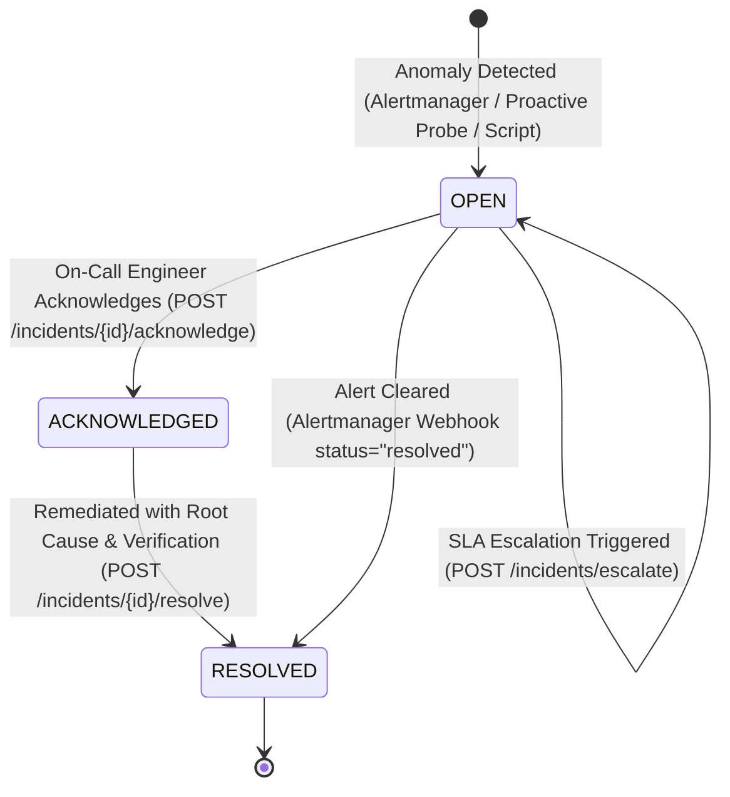

# CloudOps Sentinel — SRE Incident Management & Escalation Runbook 🛡️

This runbook defines the operational procedures, severity classifications, Service Level Agreements (SLAs), escalation policies, Alertmanager webhook integration, and disaster recovery drill execution for **CloudOps Sentinel**.

---

## 1. Incident Severity Matrix & SRE SLAs

| Severity | Definition & Trigger Examples | Target Ack SLA | Target Resolve SLA (MTTR) | Auto-Escalation Threshold |
| :--- | :--- | :--- | :--- | :--- |
| **`CRITICAL`** (P1) | Database downtime (`pg_up == 0`), Connection pool saturation $\ge 90\%$, complete API unavailability. | **$\le 15$ minutes** | **$\le 1$ hour** | **5m** $\rightarrow$ Tier 1<br>**15m** $\rightarrow$ Tier 2 |
| **`HIGH`** (P2) | Buffer cache hit ratio $< 90\%$, Connection saturation $\ge 75\%$, API 5xx errors $> 5\%$, deadlocks detected. | **$\le 30$ minutes** | **$\le 4$ hours** | **15m** $\rightarrow$ Tier 1<br>**30m** $\rightarrow$ Tier 2 |
| **`MEDIUM`** (P3) | Disk mount usage $> 75\%$ warning threshold, API latency p95 $> 500\text{ms}$. | **$\le 1$ hour** | **$\le 24$ hours** | **60m** $\rightarrow$ Tier 1 |
| **`LOW`** (P4) | Minor latency fluctuations, informational probe anomalies. | **$\le 24$ hours** | **$\le 72$ hours** | **4 hours** $\rightarrow$ Tier 1 |

---

## 2. Incident Lifecycle State Machine



### State Definitions & Guards
1. **`OPEN`**: Incident created from Alertmanager webhook dispatch, proactive health probe, or engineer alert. Timers start immediately.
2. **`ACKNOWLEDGED`**: On-call engineer has taken ownership. The `acknowledged_at` timestamp is set, stopping the Mean Time To Acknowledge (MTTA) clock.
3. **`RESOLVED`**: Root cause identified and remediation applied. The `resolved_at` timestamp is set, capturing the total Mean Time To Resolution (MTTR). `resolution_notes` and `resolved_by` are strictly required.
4. **State Machine Safeguards**:
   - Cannot acknowledge an already resolved incident.
   - Cannot resolve an already resolved incident.
   - All state transitions write an immutable entry to `incident_history`.

---

## 3. Tiered Escalation Matrix

```text
Tier 0 (Automated Triage)
  └─ Firing alerts ingested via Prometheus Alertmanager webhook
  └─ Ticket created in Sentinel DB; Grafana and Slack notified

Tier 1 (Primary On-Call SRE)
  └─ Trigger: CRITICAL unacknowledged for > 5 min, HIGH unacknowledged for > 15 min
  └─ Action: PagerDuty / On-call engineer paged directly; incident escalated to Level 1

Tier 2 (Engineering Lead & Secondary SRE)
  └─ Trigger: CRITICAL unacknowledged for > 15 min, HIGH unacknowledged for > 30 min
  └─ Action: Incident escalated to Level 2; Secondary on-call mobilized

Tier 3 (Incident Commander / Executive)
  └─ Trigger: Catastrophic data loss or multi-region outage
  └─ Action: Level 3 escalation; War room established
```

---

## 4. Alertmanager Webhook Integration

Alertmanager is configured to dispatch alerts directly to the Sentinel backend at:
`POST http://backend:8000/api/v1/incidents/webhook/alertmanager`

### Deduplication Policy
- Incoming alerts compute a deterministic fingerprint: `{alertname}:{instance}`.
- If an alert is already `OPEN` or `ACKNOWLEDGED`, subsequent firing alerts append an `ALERT_UPDATE` entry to the existing incident's audit log rather than duplicating tickets.
- When Alertmanager sends `status: "resolved"`, the incident is automatically transitioned to `RESOLVED` with `resolved_by: "alertmanager_webhook"`.

---

## 5. Safe Disaster Recovery & Outage Simulation Drill

CloudOps Sentinel provides an automated disaster recovery drill script in `scripts/incident_drill.sh`.

> [!IMPORTANT]
> **Strict Safety Guarantee**: The drill script features an automated assertion guard that aborts immediately with exit code 1 if targeted at the primary platform database (`sentinel_db` or port `5434`). It operates strictly on simulated target databases (`monitored-postgres:5433`).

### Executing the Drill
```bash
# Run against simulated target database (monitored-postgres:5433)
./scripts/incident_drill.sh localhost 5433 postgres ecommerce_production
```

### JSON Mode for CI/CD Pipelines
```bash
./scripts/incident_drill.sh localhost 5433 postgres ecommerce_production --json
```

### Drill Execution Workflow (Verified in Staging)
1. **Pre-flight Check**: Validates socket connectivity to `localhost:5433`.
2. **Outage Simulation**: Executes `docker stop monitored-postgres`.
3. **Detection**: Verifies socket refusal (`Connection Refused`) and dispatches Alertmanager firing webhook.
4. **Triage & Ack**: On-call engineer acknowledges the critical incident via REST API.
5. **Recovery**: Executes `docker start monitored-postgres` and polls `pg_isready` until healthy.
6. **Resolution**: Dispatches resolution notification with remediation notes and calculates MTTR.
7. **Post-Mortem Audit**: Fetches the incident's complete historical event log (`CREATED` $\rightarrow$ `ACKNOWLEDGED` $\rightarrow$ `RESOLVED`).

---

## 6. Incident Management REST API Quick Reference

### List Incidents with Filtering
```bash
curl -s "http://localhost:8000/api/v1/incidents/?status=OPEN&severity=CRITICAL" | jq .
```

### Get Incident Detail with Full Audit History
```bash
curl -s "http://localhost:8000/api/v1/incidents/<INCIDENT_UUID>" | jq .
```

### Acknowledge an Incident
```bash
curl -X POST "http://localhost:8000/api/v1/incidents/<INCIDENT_UUID>/acknowledge" \
  -H "Content-Type: application/json" \
  -d '{
    "acknowledged_by": "sarah.connor@acmecloud.io",
    "notes": "Acknowledged alert. Investigating database logs."
  }'
```

### Resolve an Incident
```bash
curl -X POST "http://localhost:8000/api/v1/incidents/<INCIDENT_UUID>/resolve" \
  -H "Content-Type: application/json" \
  -d '{
    "resolved_by": "sarah.connor@acmecloud.io",
    "resolution_notes": "Restarted container and verified pool connectivity."
  }'
```

### Query SRE Response & Resolution SLA Metrics
```bash
curl -s "http://localhost:8000/api/v1/incidents/metrics/sla" | jq .
```

### Generate Executive Incident Report
```bash
curl -s "http://localhost:8000/api/v1/incidents/reports/summary" | jq .
```

